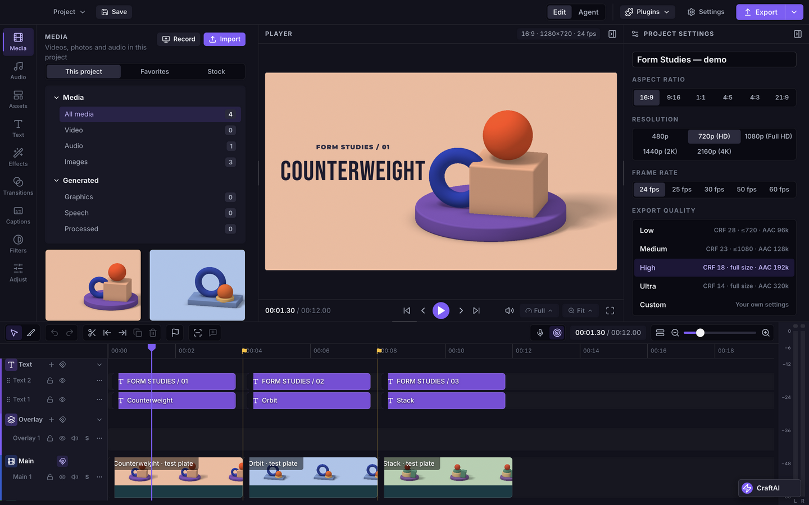

An independent fork of [Hamza Abika’s ClipCraft](https://github.com/hamzaabika/clipcraft) · [Support the original author](https://paypal.me/hamzaAbika)

# ClipCraft

**A desktop video editor with an editable timeline, an AI editing assistant and a TypeScript plugin SDK.**

[](docs/editor/first-edit.md)

**[▶ Watch the editor demo](docs/media/clipcraft-demo.mp4)**　·　[Run locally](#getting-started)　·　[Plugin SDK](#plugins-and-sdk)　·　[Documentation](docs/README.md)

## What this fork adds

### Cut an interview with CraftAI

> “Find the first complete answer in this interview. Show me the source range, then put it on the timeline with captions.”

Attach a clip or transcript. CraftAI can suggest a passage, preview the source frames and place the cut. Take over in the timeline to trim a word or change a caption. Agent edits are grouped for Undo. [Source discovery](docs/agents/source-discovery.md) · [Editing with agents](docs/agents/agent-editing.md)

### Create a graphic you can change after the cut

Ask for an animated chart, a lower third or a photo card. Open the **Graphic** inspector to change the text, numbers, pictures or timing. The overlay and its source stay in the project. [Motion graphics guide](docs/design/motion-graphics.md)

## Editing tools

[Your first edit](docs/editor/first-edit.md)　·　[Timeline](docs/editor/timeline.md)　·　[Picture and motion](docs/editor/picture-motion.md)　·　[Audio](docs/editor/audio.md)　·　[Captions](docs/editor/titles-captions.md)　·　[Export](docs/editor/export.md)

<details>
<summary><strong>Picture, motion and the timeline</strong></summary>

- Trim, split, ripple, reverse and freeze clips. Copy linked clips between projects or lock a track while cutting the others.
- Animate transforms and opacity with keyframes. Stabilize footage, track a point, draw masks, use chroma key or blend layers.
- Apply transitions, filters, curves, HSL adjustments and LUTs. Use the Effects track for a look that spans the cut.

</details>

<details>
<summary><strong>Sound, captions and media</strong></summary>

- Record voiceover, detach audio, draw volume envelopes and apply EQ, compression, noise reduction or loudness processing.
- Generate captions with on-device Whisper or a cloud service, import SRT, and animate individual words. Titles support RTL/Arabic text and imported fonts. [Watch the caption animation](docs/media/sample-caption-animation.mp4) · [Fonts](docs/media/fonts.md)
- Import local footage or animated GIFs, record your screen, or search Openverse, Pixabay, Soundza and Myinstants. Online sources can supply credits for imported media. [Media and credits](docs/architecture/openverse-media.md)

</details>

<details>
<summary><strong>Generation, projects and export</strong></summary>

- Generate scene images with a compatible Codex setup. Generate narration with a configured speech service or the optional local VoiceStudio extension. [VoiceStudio setup](docs/media/voicestudio.md)
- Duplicate or recover a project, keep its conversations beside the timeline file, or move both together with their source media. [Project files](docs/architecture/project-file.md)
- Export MP4, MOV, Matroska or WebM, or mix down to MP3, WAV or M4A. The GIF extension renders an animated range. [Formats and codecs](docs/architecture/export-experience.md#output-formats) · [GIF example](examples/extensions/gif-export/README.md)

</details>

## Plugins and SDK

|  **Creative packs** |  **Node extensions** |
| --- | --- |
| Give a project its own look with a transition, a LUT, a title style or a motion preset. Audition sounds and preview looks in **Pack content**. | Add a toolbar command, an inspector, a custom timeline track or a media source. The **Chapter markers** example adds evenly spaced markers in one Undo step. |
| [Explore the pack examples →](examples/plugin-showcase/README.md) | [Build your first extension →](packages/plugin-sdk/README.md) |

Install a compiled folder or archive in **Settings → Plugins**. For third-party Node code, **Trust & activate** grants that exact package access to files, the network and local programs.

[SDK quick start](packages/plugin-sdk/README.md) · [API reference](docs/design/plugin-extension-api.md) · [Plugin system](docs/design/plugin-system.md) · [Runnable extensions](examples/extensions/README.md)

## Getting started

From a checkout of this fork, run:

```sh
npm install
npm run dev
```

Start cutting immediately, or connect Codex, Claude, OpenCode, Ollama or a supported API provider in **Settings → AI assistant**. To work from an agent outside ClipCraft, enable **Settings → External agents**. [Native agents](docs/agents/native-agent-tools.md) · [External MCP setup](docs/agents/external-mcp.md)

## Documentation

[Editor handbook](docs/README.md) · [Extension API](docs/design/plugin-extension-api.md) · [Open the searchable local manual](docs/reader/README.md) · [Contributor index](docs/contributors/README.md) · [Contributor instructions](AGENTS.md)

## License and attribution

Hamza Abika created the original ClipCraft. This independent fork focuses on agent-assisted editing, editable motion graphics and plugins. The code uses the MIT license. The ClipCraft name and logo remain the original author’s brand. [MIT license](LICENSE) · [Third-party notices](THIRD-PARTY-NOTICES.md)
