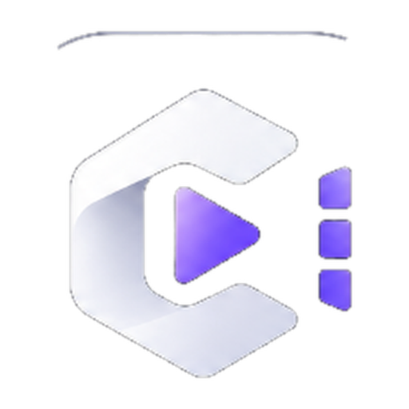
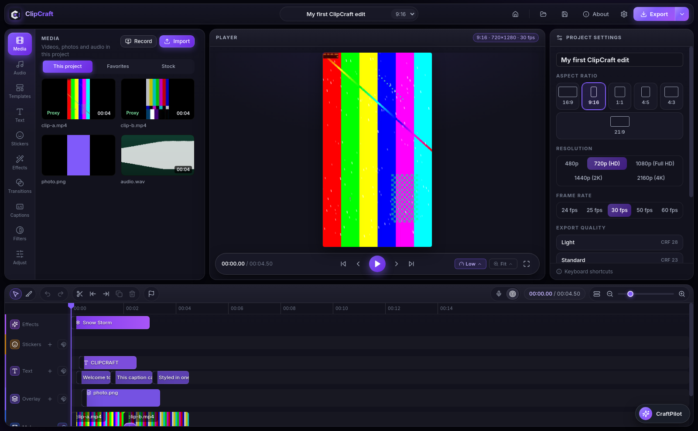
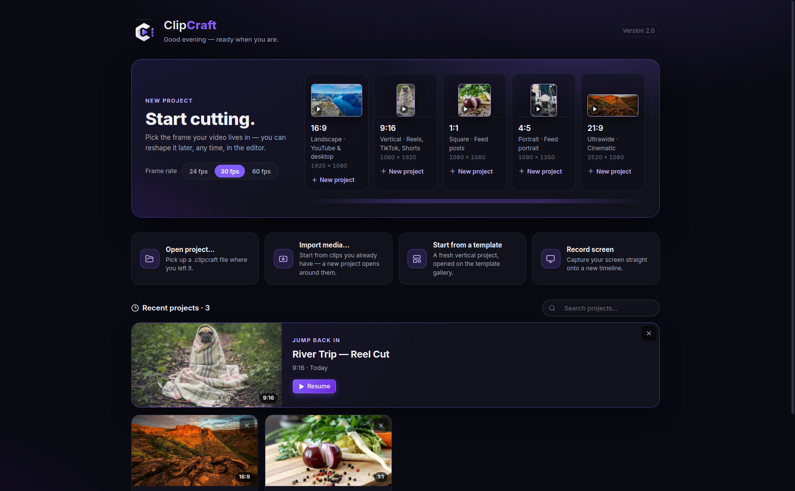
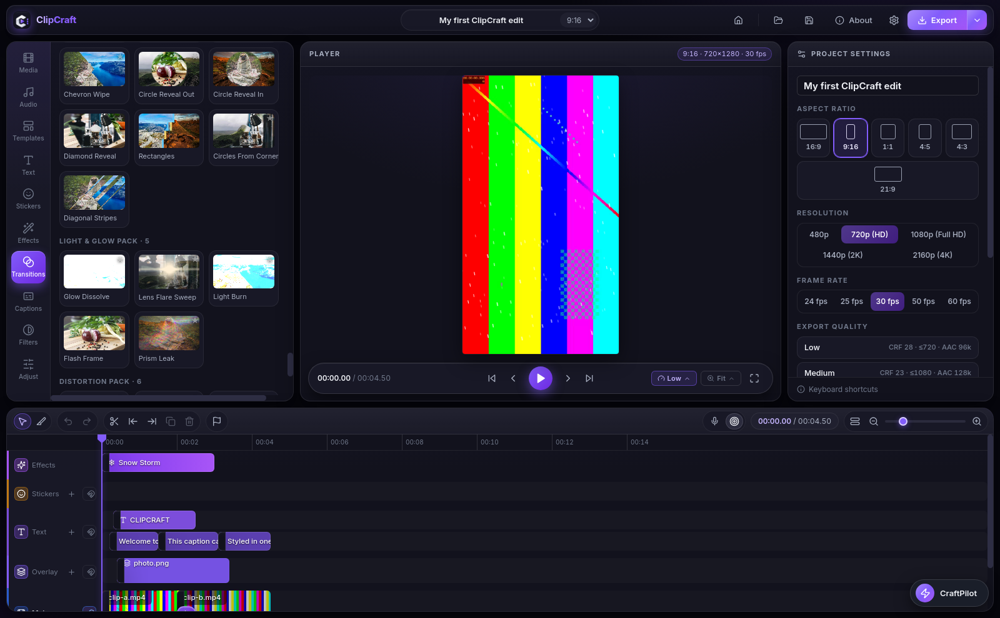
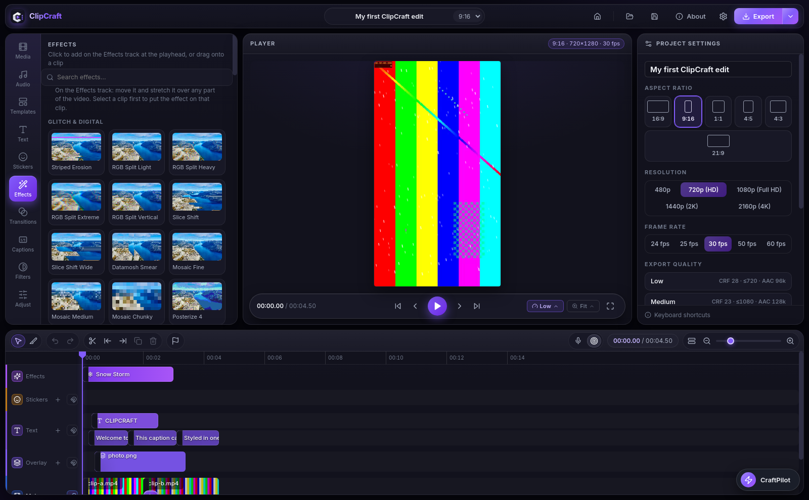
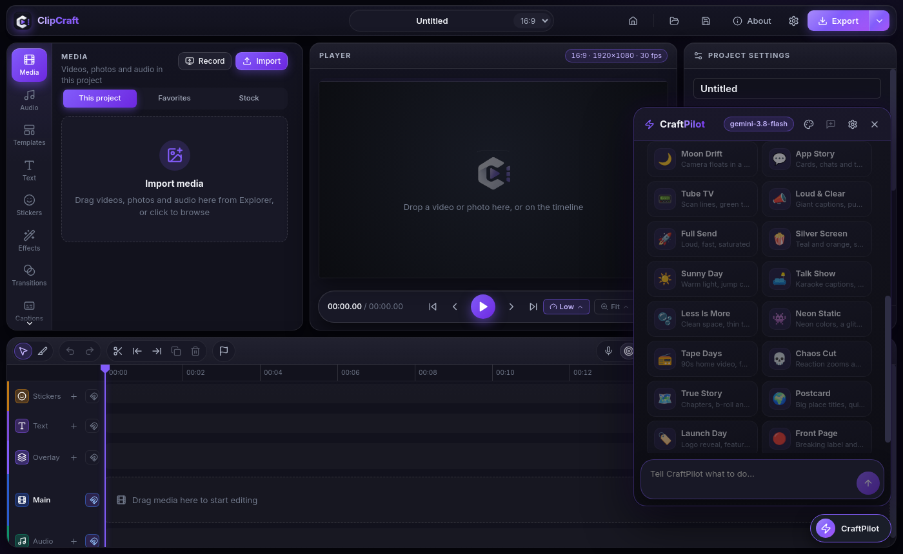

<p align="center">
  
</p>

<h1 align="center">ClipCraft</h1>

<p align="center">
  <b>A free desktop video editor for creators who want pro results without a subscription.</b>
</p>

<p align="center">
  Timeline editing · transitions &amp; effects · animated text · auto captions · offline templates · an AI assistant that works with your own API keys.<br>
  By <b>Hamza Abika</b>.
</p>

<p align="center">
  
  
  
  
  
  
</p>

<p align="center">
  <a href="https://hamzaabika.com"><b>ClipCraft on hamzaabika.com</b></a> ·
  <a href="https://instagram.com/hamza_abika">Instagram</a>
</p>

<br>

<p align="center">
  
</p>

<p align="center"><sub><i>The editor.</i> Media bin, live player and a multi-track timeline — effects, captions and overlays stacked over the picture, with project settings one click away. What the player shows is what the export renders.</sub></p>

<p align="center">
  <a href="#about">About</a> ·
  <a href="#demo">Demo</a> ·
  <a href="#highlights">Highlights</a> ·
  <a href="#transitions">Transitions</a> ·
  <a href="#effects">Effects</a> ·
  <a href="#craftai">CraftAI</a> ·
  <a href="#export">Export</a> ·
  <a href="#download">Download</a> ·
  <a href="#run-from-source">Get started</a> ·
  <a href="#status">Status</a>
</p>

<br>

## About

ClipCraft is a free desktop video editor and covers what people actually open an editor for: multi-track cutting, transitions and effects, animated titles, auto-captions, templates, stock media and clean 4K export. With none of the catches: **no watermark, no account, no subscription, no upload.** Your projects and footage stay on your computer, and everything — including the template library — works offline.

**Good for:** TikTok, Reels and Shorts, YouTube videos, tutorials and screen recordings, podcast clips.

## Demo

<p align="center">
  <a href="docs/media/clipcraft-demo.mp4"></a>
</p>

<p align="center"><b>▶ <a href="docs/media/clipcraft-demo.mp4">Watch the screen recording</a></b> — home, timeline, transitions, effects and live playback, in under a minute.<br>
<sub>Sample output: <a href="docs/media/sample-caption-animation.mp4">word-by-word caption animation</a>, exported from ClipCraft.</sub></p>

## Highlights

- 🚫 **No watermark. No account. No paywall.**
- 🔒 **100% local.** Nothing uploads. Works offline.
- 🎞️ **Multi-track timeline.** Video, audio, text, stickers, overlays and effects tracks, with keyframes, masks and chroma key.
- 🌈 **135+ transitions and a growing effects library**, every one previewed on real footage before you apply it.
- 💬 **Auto-captions.** Free on-device Whisper — including a Darija model — or bring a cloud key for speed.
- 🔤 **Animated text done properly.** Dozens of in/out animations, word-by-word styling, and real RTL/Arabic shaping.
- 🧩 **Offline templates + built-in stock.** And a screen recorder that drops captures straight onto the timeline.
- 🤖 **CraftAI.** An AI editing assistant that runs on *your* provider and *your* key.
- 🚀 **Honest export.** Presets for every platform plus full custom control — the preview never silently changes the render.

## Edit

**A timeline you already know.** Drag media in, trim on the track, stack text, stickers and overlays above the picture. Per-clip keyframes, masks, chroma key, background removal, stabilization and speed control are all there, and the player previews the real render pipeline — transitions, effects and text included.

- **Color grading** — curves, HSL, wheels and .cube LUTs.
- **Subtitles as clips** — import an SRT, restyle one caption or all of them, timing untouched.
- **Sequence guard** — if your footage doesn't match the project, ClipCraft asks before changing anything.

<p align="center">
  
</p>

<p align="center"><sub><i>Start in the frame your video lives in</i> — landscape, vertical, square, portrait or cinematic, at 24, 30 or 60 fps. Reshape later, any time, in the editor.</sub></p>

## Transitions

<p align="center">
  
</p>

<p align="center"><sub><i>Every tile is the real engine.</i> Transition previews run the actual effect on real photos, so the tile you pick is the cut you get.</sub></p>

**135+ transitions in themed packs** — Basic, Zoom, Slide, 3D, Glitch, Blur, Light, Wipe, Creative and Vintage, plus Seamless, Mask & Reveal, Light & Glow, Distortion and Cinematic packs. Set the duration, drop one between two clips, done.

## Effects

<p align="center">
  
</p>

<p align="center"><sub><i>Glitch &amp; digital, film looks, light leaks and more</i> — stack effects on any clip, or stretch one across the effects track over any part of the video.</sub></p>

## CraftAI

<p align="center">
  
</p>

<p align="center"><sub><i>An AI assistant inside the editor.</i> One-click looks, or just say what to do — cut the filler, style the captions, apply a look — and watch it work on your timeline.</sub></p>

CraftAI works with **your provider and your key** — Gemini, OpenAI, Anthropic, Groq, OpenRouter, Ollama and more. It can run multi-step edits on request, and it shows its work: you stay in control of every change.

## Export

<p align="center">
  
</p>

<p align="center"><sub><i>Presets when you're in a hurry, full control when you're not</i> — codec, CRF or bitrate, resolution up to 4K, frame rate and audio quality.</sub></p>

## Download

- **Linux (.deb)** — get the latest release from [hamzaabika.com](https://hamzaabika.com), then:

```bash
sudo apt install ./clipcraft_1.0.0_amd64.deb
```

- Windows and macOS builds are on the roadmap.

## Run from source

```bash
npm install
npm run dev             # development
npm start               # build + launch the app
npm run package:linux   # build the Linux .deb
```

| Layer | Tech |
| --- | --- |
| Shell | Electron |
| UI | React + Vite |
| Rendering | FFmpeg — one pipeline for preview and export |
| Captions | Whisper, on-device |
| AI | CraftAI — your provider, your key |

## Updates

ClipCraft checks for updates manually from **About → Check for updates** and downloads new versions in-app from hamzaabika.com. Nothing auto-installs and nothing phones home.

## Status

Version **1.0** has shipped for Linux. ClipCraft is in active development — the transitions and effects catalogs, the template library and CraftAI all grow release by release.

---

<p align="center">
  Designed and built by <b>Hamza Abika</b> — <a href="https://hamzaabika.com">hamzaabika.com</a> · <a href="https://instagram.com/hamza_abika">@hamza_abika</a><br>
  <sub>Private repository — all rights reserved.</sub>
</p>
