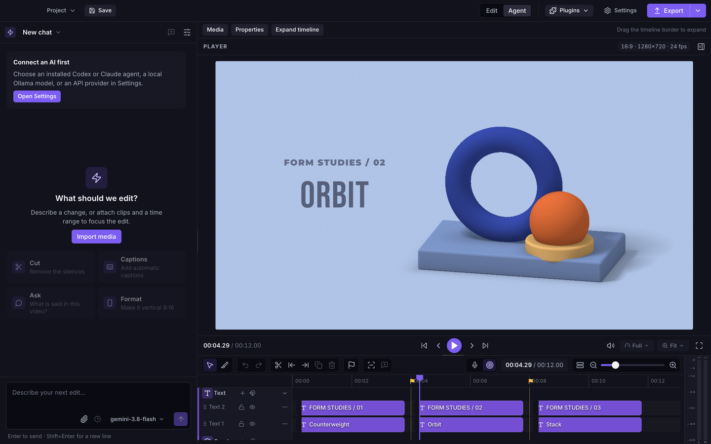

# Working with CraftAI

CraftAI can work on the current project and leave its clips, captions and graphics editable. Start by deciding what part of the source an agent should review and what change you want it to make.

## Connect an assistant

Open **Settings → AI assistant**. Choose a native Codex, Claude or OpenCode runtime, an API provider, a local Ollama connection or a compatible endpoint. Test the connection and save. Native agents use their own sign-in. In the editor, choose the **Agent** workspace for chat alongside the preview and timeline.

To drive ClipCraft from another agent application, use **Settings → External agents** and approve the connection. The external agent can inspect the open project and call editor tools. One agent controls the editor at a time. [External MCP setup](../agents/external-mcp.md)

## Make a transcript-based cut

Attach a source clip or add its time range from the timeline context menu. Ask for a specific editorial decision.

> Find the first complete answer about the river crossing. Show me the source range and its transcript before placing it on the timeline.

Review the proposed source times and preview. Ask the agent to place the selected passage, then play across the cut in the editor. **Source time** measures from the beginning of the original file. **Timeline time** measures from the beginning of your edit. A trimmed shot can have very different values for the two.

For a long interview, the agent can index portions of the source and reuse completed analysis. Check which ranges it inspected before treating a suggestion as the best passage in the entire recording. [Source discovery](../agents/source-discovery.md)

## Direct and review changes

- Give the agent selected clips, a range, a reference image or a video when the request depends on a particular subject or cut.
- Ask for a plan before a larger edit. Review tool activity and the affected timeline ranges. Play dialogue and motion yourself when timing matters. Frame inspection samples stills.
- Generate scene images with a compatible native Codex image setup, or ask for an editable chart or lower third. Use the **Graphic** inspector for later revisions. [Motion graphics](../design/motion-graphics.md)
- Use Undo to reverse a grouped agent edit. Saved chat sessions and tool activity are kept alongside the project. [Project files](../architecture/project-file.md)

[Native agent tools](../agents/native-agent-tools.md) · [Editorial plans and review](../agents/editorial-agent.md)
