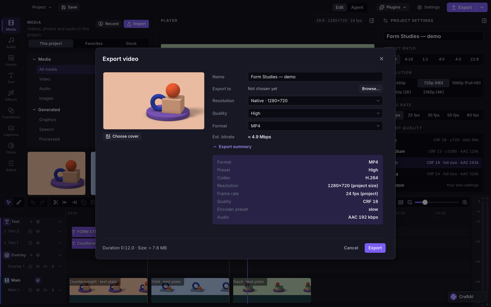

# Export and delivery

Video export renders the composed timeline, including visible text, effects and the audible mix. Choose a container for the destination player, then set the quality and dimensions.

## Make a review copy

1. Play through the first and last shots. Check titles, track visibility, muted tracks and the end of the main picture.
2. Open **Export**. Select **MP4**, **H.264** and **Medium** for a common review format. The preset caps the longest side at 1080 pixels. Read the effective output dimensions and frame rate in the dialog.
3. For MP4, choose a composed frame as the embedded cover if needed. Start export, wait for completion and open the delivered file. Check motion at a cut and the sound level during dialogue.

## Containers and codecs

Choose the container first. If a codec is absent, check the combinations below before changing the quality settings.

| Output | Video | Audio when present |
| --- | --- | --- |
| MP4 | H.264 or H.265 | AAC |
| QuickTime MOV | H.264 or H.265 | AAC |
| Matroska (MKV) | H.264, H.265 or VP9 | AAC |
| WebM | VP9 | Opus |

Availability depends on the encoders available to the app. Use **Custom** to choose constant quality (CRF) or a target bitrate. A longest-side cap only scales down. A portrait project and a landscape project with the same cap will have different output dimensions. [Quality settings and presets](../export/EXPORT-QUALITY.md)

## What sets the end of the video?

Main picture clips and custom visual or audio clips determine the renderable extent. An ordinary audio or title clip past the last picture can extend the editable document without extending the delivered video. To hold the last image under a closing line, extend the picture intentionally and check the export duration again.

Entries on metadata-only custom tracks do not add pixels, sound or video duration. Extensions can render a section within the supported extent and inspect the actual output metadata. [Range export API](../design/plugin-extension-exports.md)

## Other deliverables

- **Audio mix** — use the export menu for MP3, WAV or M4A.
- **Animated GIF** — install the GIF export extension, choose the section, size and frame rate, then review the rendered animation. [GIF example](../../examples/extensions/gif-export/README.md)
- **Credits** — copy required attribution for the media used in the edit. Include it in your delivery as appropriate. [Media and credits](../architecture/openverse-media.md)

## When export stops

Check the reported stage and the requested destination. Missing source files, fonts or an unavailable pinned plugin can affect rendering. Restore the exact dependency or make an explicit change to the project, preview the affected clip and retry. The export pipeline writes a temporary output before publishing the completed file. Canceling or failing an encode preserves an existing destination.
