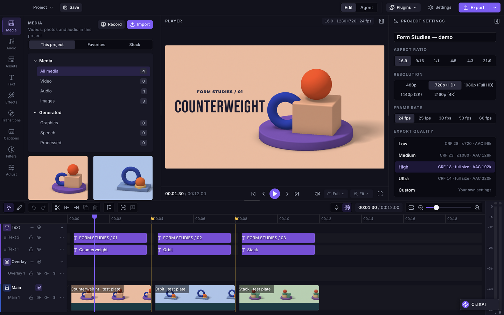

# Your first edit

Make a short landscape video from two local shots, give it a title and export an MP4. You can follow this walkthrough with two photos if you have no video footage handy.

## Open the editor

From a checkout with Node and npm installed, run the following in the repository root. If the desktop app is already open, go straight to Home.

```sh
npm install
npm run dev
```

On Home, choose **16:9** for a landscape project. The media library opens on the left, the player in the middle, the inspector on the right and the timeline below. Selecting a clip changes what the inspector shows. Clicking empty space brings back the project settings.



## Assemble two shots

1. In **Media**, choose **Import** and select two local files. Their thumbnails appear under **This project**.
2. Drag the first thumbnail onto **Main**. Drag the second after it on the same track. Press **Space** to play across the cut.
3. To shorten the first shot, drag its right edge to the left. If that leaves a gap before the second shot, close it or drag the second shot back to the cut. To cut inside a shot, select it, move the playhead inside its bounds and press **S**. Two pieces now refer to the same source.
4. Scrub across the join. Use **Left Arrow** and **Right Arrow** to check a frame on either side. Undo with **⌘Z** on macOS or **Ctrl+Z** on Windows or Linux.

## Add an opening title

Open **Text**, choose a title style and add it to the timeline. Select the new text clip and enter your title in the inspector. Move the clip above the opening shot and drag its right edge to choose when the title disappears. Play across that edge to check the timing.

## Save and export

Choose **Save** and give the project a name. This writes an editable `.clipcraft.json` document. Keep the source media accessible when you reopen it.

Choose **Export**, select **MP4**, then use H.264 and the **Medium** preset for a review copy. Check the output dimensions and frame rate in the summary before starting the export. Open the finished video and check the cut and the title. You can return to the project file to change either. [Export and delivery](export.md)

## Where to go next

- To put a second image over a shot or keep sound in sync as you cut, see [timeline editing](timeline.md).
- To add dialogue captions, see [titles and captions](titles-captions.md).
- For a recorded walkthrough, open the [editor demo](../media/clipcraft-demo.mp4).
