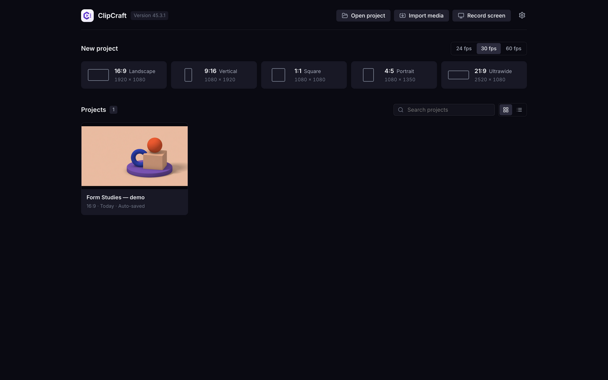

# Projects, media and recording

A project stores editing decisions and references to its media. Use the library to collect source material, then place the parts you want on the timeline.

## Choose a canvas

Choose the frame on Home before importing your first shot. **16:9** fits a landscape video, **9:16** a vertical video, **1:1** a square, **4:5** a portrait feed and **21:9** a wide composition. With no clip selected, the project inspector lets you review the aspect ratio, resolution and frame rate. Changing the canvas can change how a crop or title fits. Check the player after a change.

If the first imported video differs from the project sequence, the editor can offer **Change project settings** to match its dimensions and frame rate, or **Keep current settings** to fit the clip inside the existing frame. Compare the two sizes before choosing.

## Import and organize

Use **Media → Import** for local video, photos, animated GIFs and audio. Browse **This project** to see what is available. A library item can appear in several clips. Trimming one instance changes its source range for that edit.

Use **Main** for the base picture, **Overlay** for a picture over another shot and **Audio** for sound you want to position independently. For large footage, a proxy provides a scaled playback copy. The original supplies the export. Keep the source file when clearing playback caches.

## Use online media and credits

Open the stock browser for photos or videos, or the online section in Audio for sounds. Filters include the sources available for that media kind. ClipCraft ships Openverse, Pixabay, Soundza and Myinstants integrations. A source may require a key in **Settings → Plugins**.

Preview a result, inspect its license and source link, then import it. Imported items can retain the creator, source and attribution text. **Audio → Credits** lists credits used on the timeline. The export dialog can copy them for your description or end credits. [Provider filters and attribution](../architecture/openverse-media.md)

## Record a screen or window

Choose **Record** in Media and pick a screen or window. Select system sound, microphone and optional camera as needed. Grant the operating system access to the chosen devices when prompted. Stop the recording and check the result in the project before trimming it. If the microphone is silent, check the selected input device separately from the system-audio setting.

## Save, duplicate and move

| What you want | What to keep |
| --- | --- |
| Reopen a named edit | The `.clipcraft.json` file and all referenced media. |
| Keep CraftAI conversations | The matching `.clipcraft.chat.json` beside the project file. |
| Make another version | Duplicate the project for a separate edit. The copy has its own project identity and a fresh conversation. Both edits can reference the same footage. |
| Restore an interrupted edit | Use the recovery offer on Home. Check the restored timeline and save the version you intend to keep. |
| Move an edit with pack effects or custom tracks | Keep the exact installed package versions as well as the media. Restore any missing dependencies before export. |

[Project file and chat storage](../architecture/project-file.md) · [Using plugins](../design/plugin-system.md)

## Reuse a template

On a template project, the strip above the timeline lists replaceable clips. Select a slot and pick your video or photo. The replacement occupies the slot’s place and duration. Scrub both edges after replacing it. To turn one of your own clips into a slot, open its context menu and choose **Make replaceable (template)**. Save a copy of the project if you want to keep the original edit.
