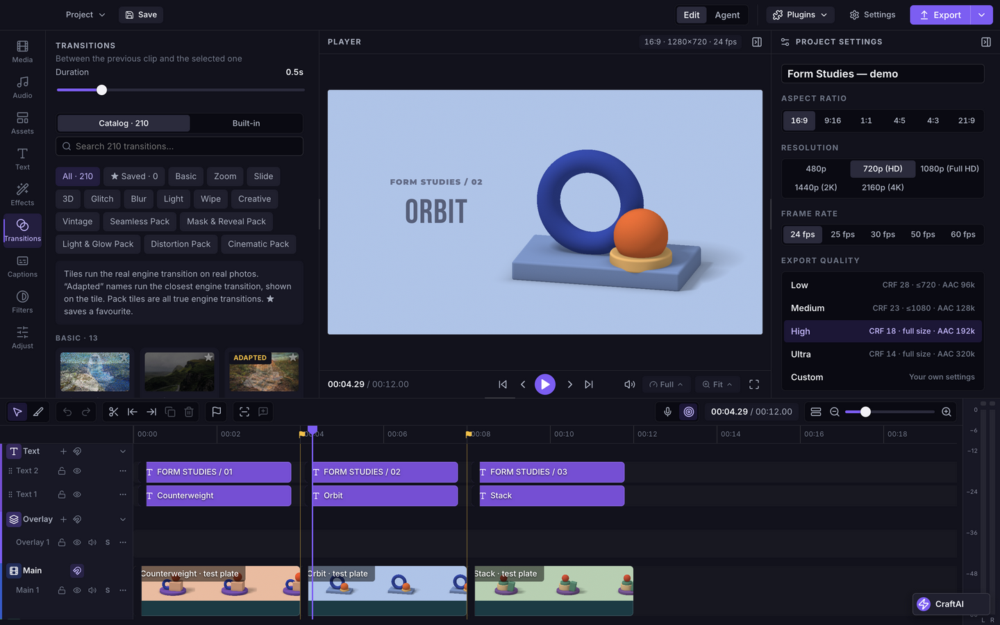

# Picture and motion

Select a picture clip before changing its framing, motion or effects. The player shows the composed result and the inspector controls the selected clip. Place a picture on an overlay track if another shot should remain visible beneath it.

## Reframe a shot

Move, scale or rotate the selected picture using the player handles or its inspector. Crop to remove unwanted areas of the source. When the project and source have different aspect ratios, check the edges of the frame and decide whether to keep the whole image or fill the canvas.

A mask limits the visible region of a layer. Chroma key removes a selected background color so the layer underneath shows through. Check the edges against the actual underlying footage. Fine details that look clean against black may need another adjustment against a bright shot.

## Animate a move

1. Place the playhead at the start of the motion and set the first keyframe for the property you want to animate, such as position, scale or opacity.
2. Move the playhead later in the clip and set the ending value and keyframe.
3. Play through the interval. Use the curve editor to change how the motion accelerates or settles. Check the frame before and after the move as well as its midpoint.

## Track a subject or stabilize a shot

To attach a label or overlay to a moving subject, select the **source video** and choose **Motion tracking → Track motion**. Pick a distinct point in the player and let the analysis finish. Select the **overlay or text clip**, position it where it should start, then use **Pin to track** to select the tracked source. The overlay keeps its starting offset and follows the point. If the point drifts, select the source and choose **Track again**.

To steady handheld footage, select the video clip, open **Stabilize** and choose a strength. The editor analyzes the selected source range and prepares a processed copy. Check the edges of the frame for excessive crop. Choose **Off** to restore the original footage.

## Grade, filter or transition

| Goal | Tool |
| --- | --- |
| Correct an individual shot | Adjust its color controls. Curves and HSL controls let you target tonal ranges or colors. |
| Reuse a look | Apply a filter, a LUT or an installed color preset. Compare on a face or neutral object before committing to the strength. |
| Treat a span of the edit | Place the look on the Effects track and adjust its duration over the shots it should affect. |
| Blend neighboring shots | Choose a transition at their join. Review the frames on both sides of the overlap, especially after a trim. |
| Change an authored effect | Select its effect slot in the inspector and edit the parameters that the pack exposes. |

For a look applied to a shot, open the [Effects library in the same demo](../screenshots/effects.png).

## Edit a generated graphic

A CraftAI motion graphic becomes a transparent overlay. Select it and open the **Graphic** inspector to edit its exposed text, images, data or timing. A valid change previews in the editor while a full-quality render prepares. Export waits for the current render. [Motion graphics inputs and rendering](../design/motion-graphics.md)
